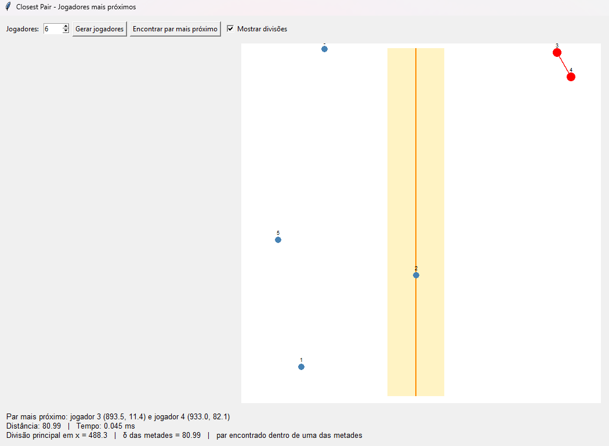
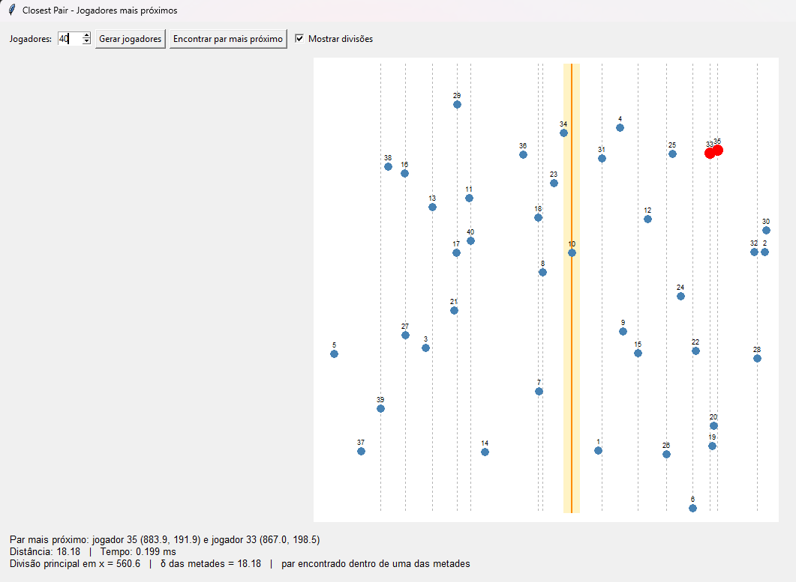
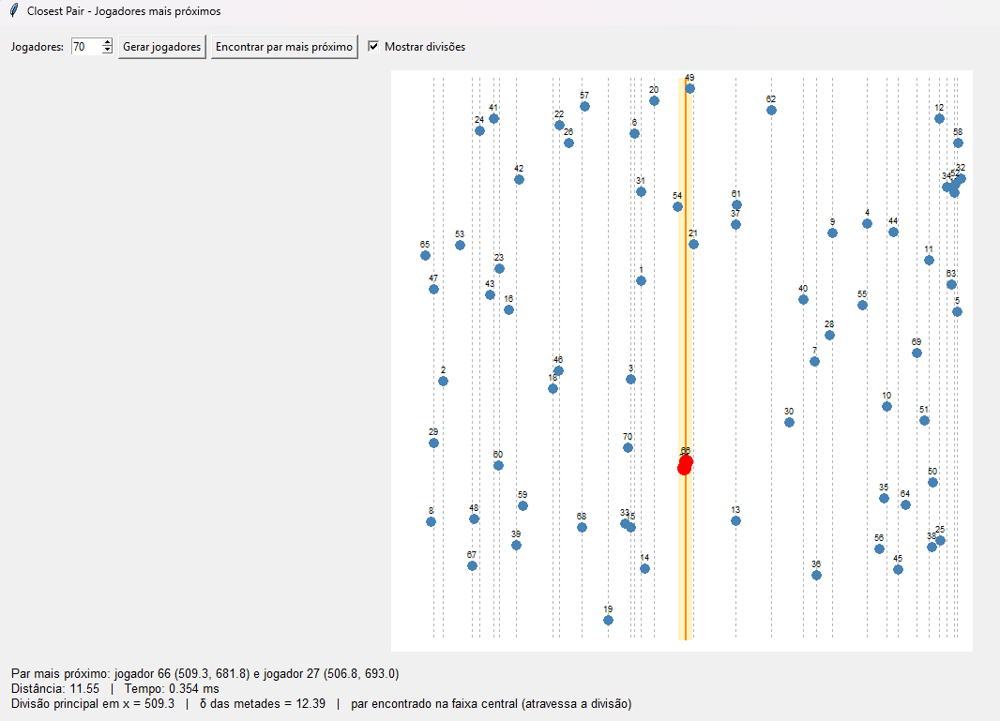

# Battle Royale Radar com Closest Pair

## Alunos

| Matrícula | Aluno |
| -- | -- |
| 211041105 | Bruna de Lima Santos |
| 212005453 | Pedro Luciano de Azevedo |

## Sobre

Trabalho 3 da disciplina de Projeto de Algoritmos do 2º semestre de 2026. O sistema simula jogadores distribuídos em um mapa e identifica os dois que estão mais próximos entre si.

### Problema

Em uma partida de Battle Royale, cada jogador ocupa uma posição no mapa representada pelas coordenadas `x` e `y`. O objetivo é encontrar o par de jogadores com a menor distância euclidiana.

Uma solução que compara todos os pares possíveis possui complexidade `O(n²)`. Para tornar a busca mais eficiente, o projeto aplica o algoritmo **Closest Pair of Points** com a estratégia de **Dividir e Conquistar**.

### Solução

A interface permite escolher a quantidade de jogadores da partida. As posições são geradas aleatoriamente dentro de um mapa de `1000 × 1000` unidades.

Ao executar o algoritmo, o sistema apresenta:

- Os dois jogadores mais próximos;
- As coordenadas de cada jogador;
- A distância entre eles;
- O tempo de execução do algoritmo;
- A região em que o par foi encontrado.

A interface também pode exibir as divisões realizadas durante a recursão. A divisão principal aparece em laranja, as divisões internas em cinza e a faixa central analisada pelo algoritmo em amarelo.

### Algoritmo

O Closest Pair começa ordenando os jogadores pelas coordenadas `x` e `y`. Em seguida, o conjunto é dividido recursivamente em duas metades.

Para cada divisão:

1. Encontra-se o par mais próximo da metade esquerda;
2. Encontra-se o par mais próximo da metade direita;
3. A menor das duas distâncias é armazenada como `δ`;
4. É criada uma faixa central com os jogadores cuja distância horizontal até a divisão é menor que `δ`;
5. Os jogadores da faixa são analisados em ordem crescente de `y`;
6. Cada jogador é comparado com, no máximo, os sete jogadores seguintes;
7. O menor resultado encontrado é retornado.

Quando o subconjunto possui até três jogadores, o algoritmo compara diretamente os pares possíveis. Esse é o caso base da recursão.

### Formato de entrada

A entrada é informada diretamente pela interface. O usuário escolhe uma quantidade entre 2 e 100 jogadores e seleciona **Gerar jogadores**.

Cada jogador possui a seguinte estrutura:

```python
Jogador(
    id=1,
    x=425.7,
    y=183.2,
)
```

O identificador é sequencial, enquanto as coordenadas `x` e `y` são geradas aleatoriamente entre 0 e 1000.

### Complexidade

A ordenação inicial dos jogadores custa `O(n log n)`. Em cada nível da recursão, os jogadores são divididos e a faixa central é analisada em tempo linear. Como existem `O(log n)` níveis, a complexidade final permanece `O(n log n)`.

| Operação | Complexidade |
| -- | -- |
| Gerar os jogadores | `O(n)` |
| Calcular uma distância | `O(1)` |
| Ordenar por `x` e por `y` | `O(n log n)` |
| Processar a recursão e as faixas | `O(n log n)` |
| Desenhar os jogadores | `O(n)` |
| **Complexidade final** | **`O(n log n)`** |

O espaço auxiliar utilizado pelas listas ordenadas e pelas divisões é `O(n)`.

## Screenshots

### Cenário 1

Este cenário utiliza poucos jogadores para facilitar a visualização das posições.

- **Quantidade de jogadores:** 6;
- **Par mais próximo:** jogadores 3 e 4;
- **Distância:** 80,99;
- **Região do resultado:** uma das metades.



### Cenário 2

Com 40 jogadores, o mapa possui mais pontos e mais divisões recursivas. 

- **Quantidade de jogadores:** 40;
- **Par mais próximo:** jogadores 35 e 33;
- **Distância:** 18,18;
- **Região do resultado:** uma das metades.



### Cenário 3: 70 jogadores

Este cenário apresenta uma quantidade maior de jogadores e demonstra a importância da faixa central.

- **Quantidade de jogadores:** 70;
- **Par mais próximo:** jogadores 66 e 27;
- **Distância:** 11,55;
- **Região do resultado:** faixa central, atravessando a divisão.



## [Clique aqui para assistir à apresentação](https://youtu.be/EoSLwD-H_dw)

## Instalação

### Pré-requisitos

Antes de começar, certifique-se de ter:

- Python 3.10 ou superior;
- Git.

### 1) Clone o repositório

```bash
git clone https://github.com/projeto-de-algoritmos-2026/G29_Dividir-e-Conquistar_PA-26.2.git
cd G29_Dividir-e-Conquistar_PA-26.2
```

### 2) Instale as dependências do sistema

Em distribuições baseadas em Ubuntu ou Debian:

```bash
sudo apt update
sudo apt install python3 python3-venv python3-tk
```

### 3) Crie e ative o ambiente virtual

```bash
python -m venv .venv
source .venv/bin/activate
```

### 4) Instale as dependências do projeto

```bash
python -m pip install -r requirements.txt
```

## Execução

Na raiz do projeto, ative o ambiente virtual:

```bash
source .venv/bin/activate
```

Em seguida, execute:

```bash
python -m src.main
```

### Testes

```bash
python -m pytest
```
